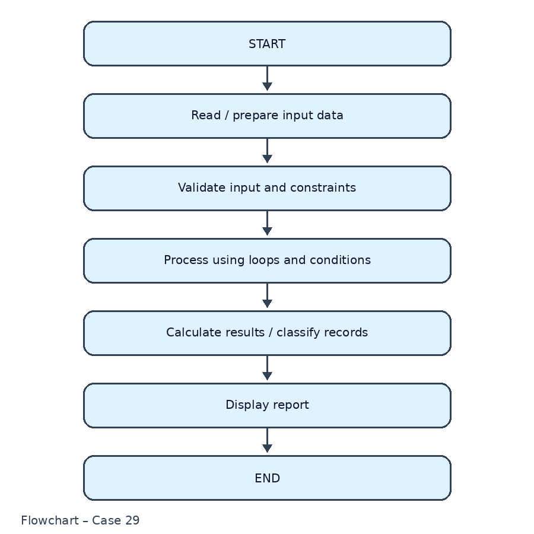
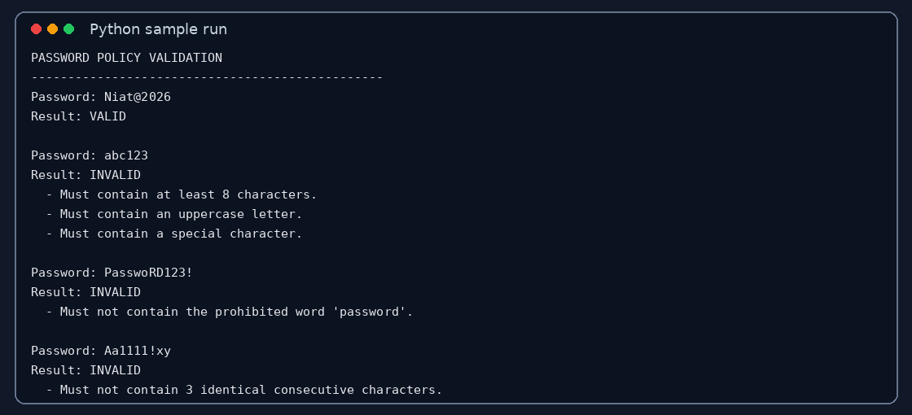

# Case Study 29: Password Policy Validation Engine

## 1. Problem Statement
Evaluate sample password strings against minimum length, character-category, repetition, and prohibited-substring rules, and explain every failed condition.

## 2. Objectives
- Check password length and character categories.
- Detect consecutive repeated characters.
- Reject passwords containing a prohibited substring.
- Report all failed rules instead of only the first failure.

## 3. Assumptions
- Minimum length is 8 characters.
- A valid password must contain uppercase, lowercase, a digit, and a special character.
- Three identical consecutive characters are prohibited.
- The substring 'password' is prohibited without case sensitivity.

## 4. Algorithm
1. Receive a password string.
2. Check its length.
3. Scan characters to identify uppercase, lowercase, digit, and special character categories.
4. Scan adjacent characters for three consecutive identical characters.
5. Check for the prohibited substring after converting to lowercase.
6. Collect and display all failed conditions.
7. Declare the password valid only if no rule failed.

## 5. Flowchart
The diagram below shows the overall program flow. Detailed case-specific decisions are implemented in `solution.py`.



## 6. Pseudocode
```text
START
READ password
CREATE empty failed_rules list
IF length < 8, ADD minimum-length failure
SCAN characters and set category flags
IF any category is missing, ADD relevant failure
SCAN each group of 3 adjacent characters
IF all 3 are equal, ADD repetition failure
IF 'password' occurs in lowercase password, ADD prohibited-substring failure
IF failed_rules is empty, DISPLAY VALID
ELSE DISPLAY INVALID and all failures
STOP
```

## 7. Python Source Code
See [`solution.py`](solution.py). The program uses Python built-in features and no third-party packages.

## 8. Test Cases

| Test | Input / condition | Expected result |
|---|---|---|
| Valid password | Niat@2026 | No failed rules; VALID |
| Too short | abc123 | Length, uppercase, and special-character failures |
| Prohibited substring | PasswoRD123! | Prohibited word failure (case-insensitive) |
| Repeated characters | Aa1111!xy | Consecutive repetition failure |
| Missing special character | Abcdefg1 | Special-character failure |

## Sample Output
The included program was run with the sample data in `main()`. The captured output is also saved as `sample_output.txt`.



## 9. Output Screenshot
This terminal-style screenshot is a generated capture of the sample program output. Run `python solution.py` to reproduce it.

## 10. Conclusion
The validator checks multiple password rules in one pass and explains every failure. It demonstrates string operations, loops, flags, and conditional logic.
